# Cluster Architecture & Topology

This document details the architecture, networking, storage, and component interactions of the k3s cluster hosting **Forgejo**, **Forgejo Runner**, **Plane (`plane.so`)**, and **It's a Plan (`itsaplan.dev`)**.

---

## 1. High-Level Architecture Diagram

```mermaid
flowchart TD
    subgraph Clients ["Public Network / Clients / Developers"]
        DevBrowser["Web Browsers\n(Developers & Project Managers)"]
        GitClient["Git CLI & SSH Clients"]
        AIAgents["AI Agents\n(Claude Code, CLI, MCP)"]
    end

    subgraph Edge ["Cluster Edge (Ports 80, 443, 32222)"]
        Traefik["Traefik Ingress Controller\n(Bundled with k3s, HostPort 80/443)"]
        CertManager["cert-manager v1.17\n(ACME HTTP-01 / Let's Encrypt)"]
        SSHNodePort["Forgejo SSH Service\n(NodePort 32222)"]
    end

    subgraph K3sCluster ["k3s Kubernetes Cluster"]
        subgraph NS_Forgejo ["Namespace: forgejo"]
            ForgejoWeb["Forgejo Server\n(Git Repos, Web UI, API)"]
            ForgejoDB["PostgreSQL 16"]
            ForgejoPVC[("local-path PVC\n(/data/git)")]
        end

        subgraph NS_Runner ["Namespace: forgejo-runner"]
            RunnerDaemon["Forgejo Runner\n(act_runner daemon)"]
            DinD["Docker-in-Docker Daemon\n(docker:27-dind sidecar)"]
            RunnerPVC[("local-path PVC\n(/data)")]
        end

        subgraph NS_Plane ["Namespace: plane"]
            PlaneWeb["Plane Frontend (Web)"]
            PlaneAPI["Plane Backend API"]
            PlaneWorker["Plane Celery Worker"]
            PlaneDB["PostgreSQL 15"]
            PlaneRedis["Redis Cache"]
            PlaneMinio["MinIO Storage"]
            PlaneMQ["RabbitMQ"]
        end

        subgraph NS_ItsAPlan ["Namespace: itsaplan"]
            ItsAPlanWeb["It's a Plan Web (3001)"]
            ItsAPlanAPI["It's a Plan API (3000)"]
            ItsAPlanWorker["Worker (Webhooks & Tasks)"]
            ItsAPlanBot["Bot (Agent Integration)"]
            ItsAPlanDB["PostgreSQL 17"]
            ItsAPlanS3["RustFS / MinIO (S3)"]
        end
    end

    DevBrowser -->|HTTPS 443| Traefik
    AIAgents -->|HTTPS 443| Traefik
    GitClient -->|SSH :32222| SSHNodePort
    SSHNodePort --> ForgejoWeb

    Traefik -->|git.domain| ForgejoWeb
    Traefik -->|plane.domain| PlaneWeb
    Traefik -->|itsaplan.domain| ItsAPlanWeb
    Traefik -->|api.itsaplan.domain| ItsAPlanAPI
    CertManager -.->|Issue & Renew TLS| Traefik

    ForgejoWeb --- ForgejoDB
    ForgejoWeb --- ForgejoPVC

    RunnerDaemon -->|Poll Jobs| ForgejoWeb
    RunnerDaemon -->|Execute Steps via socket| DinD
    RunnerDaemon --- RunnerPVC

    PlaneWeb --> PlaneAPI
    PlaneAPI --- PlaneDB
    PlaneAPI --- PlaneRedis
    PlaneAPI --- PlaneMinio
    PlaneAPI --- PlaneMQ
    PlaneWorker --- PlaneMQ

    ItsAPlanWeb --> ItsAPlanAPI
    ItsAPlanAPI --- ItsAPlanDB
    ItsAPlanAPI --- ItsAPlanS3
    ItsAPlanWorker --- ItsAPlanDB
    ItsAPlanBot --- ItsAPlanDB
```

---

## 2. Network Routing & Ingress Mapping

| Service | Subdomain / URL | Target Service | Internal Port | Protocol |
| :--- | :--- | :--- | :--- | :--- |
| **Forgejo Web / Git** | `git.<base_domain>` | `forgejo-http.forgejo` | `3000` | HTTPS (443) |
| **Forgejo Git SSH** | `<base_domain>:32222` | `forgejo-ssh.forgejo` | `2222` | TCP (32222) |
| **Plane UI** | `plane.<base_domain>` | `plane-app.plane` | `80/3000` | HTTPS (443) |
| **It's a Plan UI** | `itsaplan.<base_domain>` | `itsaplan-web.itsaplan` | `3001` | HTTPS (443) |
| **It's a Plan API** | `api.itsaplan.<base_domain>` | `itsaplan-api.itsaplan` | `3000` | HTTPS (443) |

---

## 3. Storage Architecture

All persistent workloads use k3s's built-in **`local-path`** storage provisioner, allocating dynamic directories on the host filesystem under `/var/lib/rancher/k3s/storage/`:
- **Forgejo**: Repositories, LFS assets, avatar icons.
- **Forgejo Runner**: `.runner` credentials, workspace caches, DinD graph drivers (`/var/lib/docker`).
- **Plane**: PostgreSQL database, MinIO attachments bucket, Redis cache.
- **It's a Plan**: PostgreSQL 17 database, RustFS attachment files (`/data`).

---

## 4. Security & Isolation

1. **Namespace Isolation**: Each tool runs in its own dedicated namespace (`forgejo`, `forgejo-runner`, `plane`, `itsaplan`, `cert-manager`).
2. **DinD Isolation**: The privileged container is strictly restricted to the `forgejo-runner` namespace. DinD runs with its own isolated Docker daemon.
3. **Encrypted Secrets**: It's a Plan utilizes AES-256-GCM (`APP_ENCRYPTION_KEY`) for encrypting AI provider credentials and API keys stored in PostgreSQL.
4. **Automated TLS**: cert-manager provisions valid Let's Encrypt certificates using HTTP-01 challenges through Traefik.
